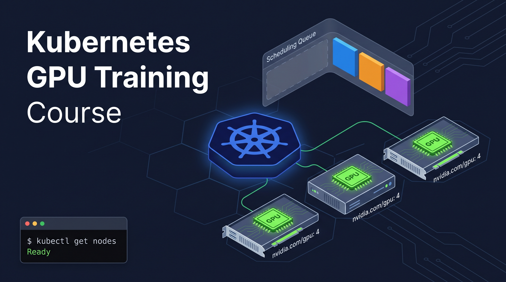

# GPU Engineering on Kubernetes

**Course 1 of 3** — GPU-Aware Kubernetes: Scheduling, Observability & Inference

A hands-on training for DevOps/SRE engineers who need to operate GPU clusters
for AI/ML workloads. No GPU hardware required for the first 4 modules — everything
runs in simulation on your laptop.

From 0 to Hero, but some basic Kubernetes knowdledge is required.

   

---


## What this course covers

You'll go from zero GPU knowledge to deploying and benchmarking a real vLLM inference
server on a GCP GPU node. Along the way you'll build the skills to run a multi-tenant
GPU platform with quota enforcement, autoscaling, and production observability.

---

## Module structure

| # | Module | Tier | Est. time |
|---|--------|------|-----------|
| 1 | GPU Fundamentals for K8s Engineers | Tier 1 (local) | 2 hr |
| 2 | Simulating GPU Clusters with KWOK | Tier 1 (local) | 3 hr |
| 3 | GPU-Aware Scheduling (Kueue + Volcano) | Tier 1 (local) | 4 hr |
| 4 | GPU Node Lifecycle & Autoscaling | Tier 1 (local) | 2 hr |
| 5 | GPU Observability with DCGM | Tier 1→2 | 3 hr |
| 6 | NVIDIA GPU Operator in Production | Tier 2 (GCP) | 2 hr |
| 7 | LLM Inference Serving with vLLM | Tier 2 (GCP) | 3 hr |
| 8 | Capstone: Multi-Tenant GPU Platform | Tier 1 + 2 | 4 hr |

---

## Two tiers, one course

**Tier 1 — Local simulation (no GPU hardware needed)**
Modules 1–4 run entirely on your laptop using KWOK virtual nodes and ghostgpu
to simulate GPU resources. RAM footprint is ~2 GB. Any 16 GB machine with Docker
can run it.

**Tier 2 — GCP GPU (real hardware)**
Modules 5–8 connect to a GCP cluster. The cost guardrail is < $10 per student
per session. A `g2-standard-4` node (1× L4 GPU, 24 GB VRAM) is used for
single-student exercises; an `a2-highgpu-1g` with 7× MIG partitions is used for
shared multi-student labs.

---

## Prerequisites

- CKA-level Kubernetes knowledge (or equivalent experience)
- Basic Linux comfort (systemd, bash, curl)
- Docker installed and working
- 16 GB RAM on your laptop
- No GPU knowledge required — that's what Module 1 is for
- No CUDA or ML framework experience needed for Course 1

---

## How to run Tier 1 locally

The lab uses **kwokctl's binary runtime** — a full simulated cluster (etcd +
kube-apiserver + kwok controller) running as plain Linux binaries. No kind, no
Docker, no VM. This is the same mechanism baked into the playground image, so you
can reproduce the lab environment on any Linux host (or in a Linux container).

### 1. Install dependencies

```bash
# kubectl
curl -fsSL -o kubectl https://dl.k8s.io/release/v1.31.3/bin/linux/amd64/kubectl
chmod +x kubectl && sudo mv kubectl /usr/local/bin/kubectl

# kwokctl — ships the binary runtime (etcd + kube + kwok)
curl -fsSL -o kwokctl https://github.com/kubernetes-sigs/kwok/releases/download/v0.6.0/kwokctl-linux-amd64
chmod +x kwokctl && sudo mv kwokctl /usr/local/bin/kwokctl

# helm — used by the ghostgpu install step
curl https://raw.githubusercontent.com/helm/helm/main/scripts/get-helm-3 | bash

# jq — used by the setup/validation scripts
sudo apt-get install -y jq   # or: brew install jq
```

### 2. Create the simulation cluster

```bash
# Creates a kwokctl binary-runtime cluster + 3 virtual GPU nodes.
# Pins the Kubernetes version via KWOK_KUBE_VERSION (kwokctl has no --kube-version flag).
bash course-1/scripts/setup-kwok-cluster.sh
```

### 3. Install the GPU simulator

```bash
# Installs ghostgpu (fake-gpu-operator) to inject nvidia.com/gpu resources
bash course-1/scripts/install-ghostgpu.sh
```

### 4. Verify the setup

```bash
# Should show 3 Ready gpu-worker nodes
kubectl get nodes

# After ghostgpu is installed, each node reports nvidia.com/gpu in allocatable
kubectl get nodes -o json | jq '.items[] | {name: .metadata.name, gpu: .status.allocatable["nvidia.com/gpu"]}'
```

> **Note:** `kwokctl --runtime=binary` downloads the kube/etcd binaries from
> `dl.k8s.io` on the first `create`. The playground image pre-caches these at build
> time so boot is offline; running locally, the first create needs network access.

---

## Lab image

The iximiuz playground boots a custom OCI image (`rootfs/Dockerfile`) built with
`make build` and pushed with `make push`. It ships `kubectl`, `kwokctl`, `helm`,
`jq`, and the course repo, and pre-warms the kwokctl binary-runtime cache at build
time so the cluster comes up fully offline in seconds at playground start.

> **Note on image size:** the image is large (~6 GB) because the pre-cached
> Kubernetes and etcd binaries dominate it. To slim it, the kube/etcd binaries are
> the bulk and there are ways to trim them — strip debug symbols and drop unused
> components. Not required for correctness; iximiuz caches the image after the first
> pull, so student boot time is unaffected.

Build and publish:

```bash
make build REGISTRY=ghcr.io/mercadoalex
make push  REGISTRY=ghcr.io/mercadoalex
make tag-latest REGISTRY=ghcr.io/mercadoalex
labctl playground update -f playground/playground.yaml <playground-slug>
```

---

## Directory layout

```
course-1/
├── manifests/    # Kubernetes YAML files (Kueue, Volcano, GPU Operator, etc.)
├── tasks/        # iximiuz auto-graded task definitions
├── scripts/      # Setup, validation, and benchmark scripts
├── dashboards/   # Grafana dashboard JSON exports
├── module-1/     # GPU Fundamentals
│   └── 1.lesson-gpu-fundamentals/
│       ├── index.md       # Lesson frontmatter + task definitions
│       ├── unit-1.md      # All lesson content
│       └── __static__/    # Lesson diagrams
└── README.md     # This file
```

---

## Cost guardrail

Tier 2 (GCP) sessions are designed to stay under **$10 per student**. The scripts
in `course-1/scripts/` include cost checks. GKE Cluster Autoscaler handles
scale-to-zero — GPU nodes spin down when idle.

See `deploy/node-pools/` for GKE CA node pool configs and `.kiro/steering/budget-rules.md`
for the full cost policy.
